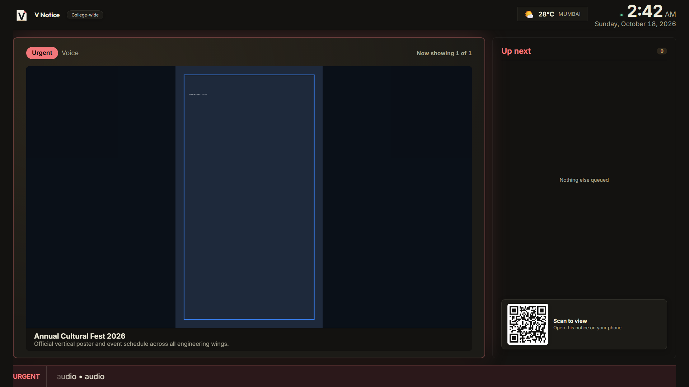
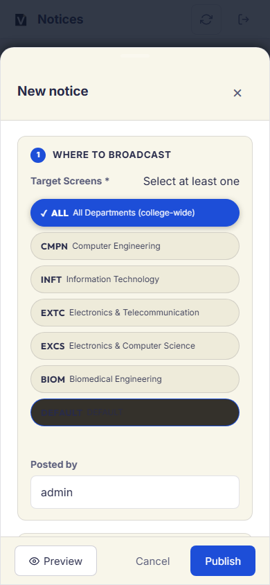
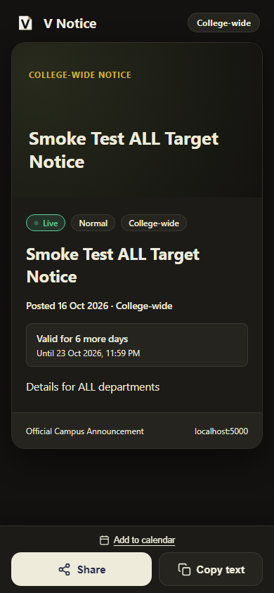
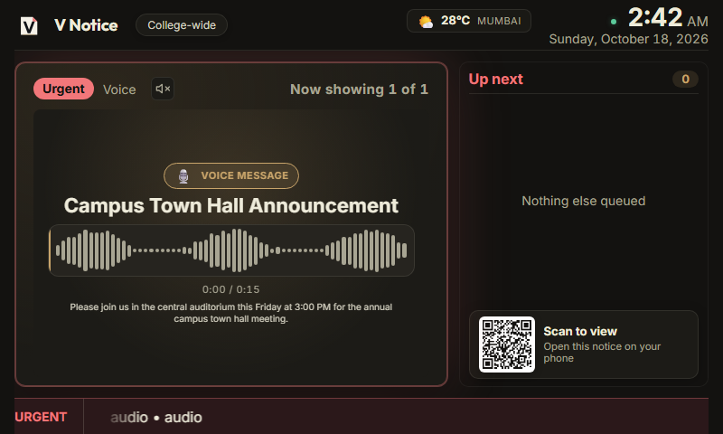
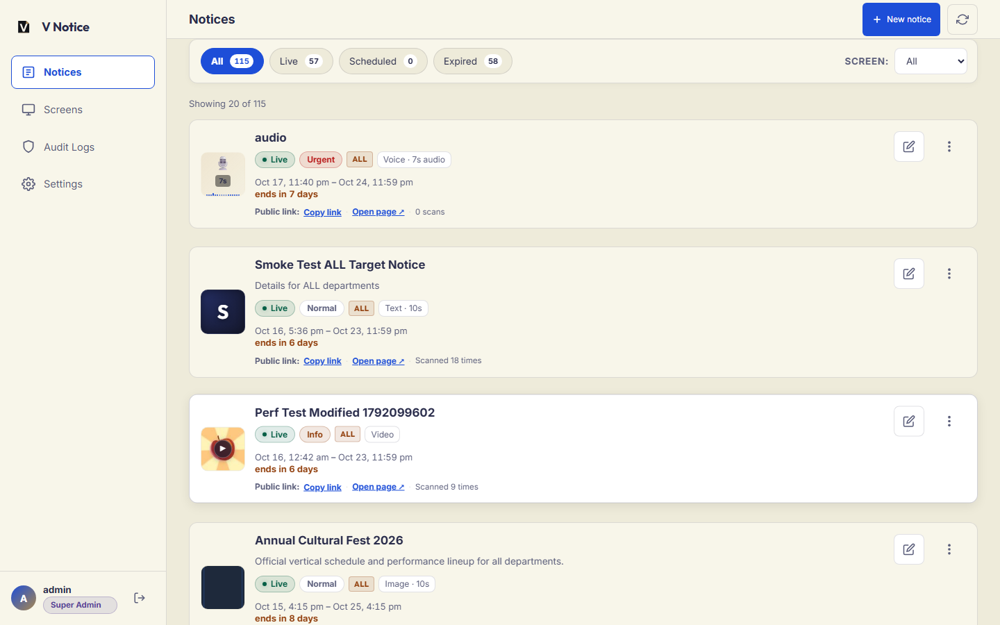
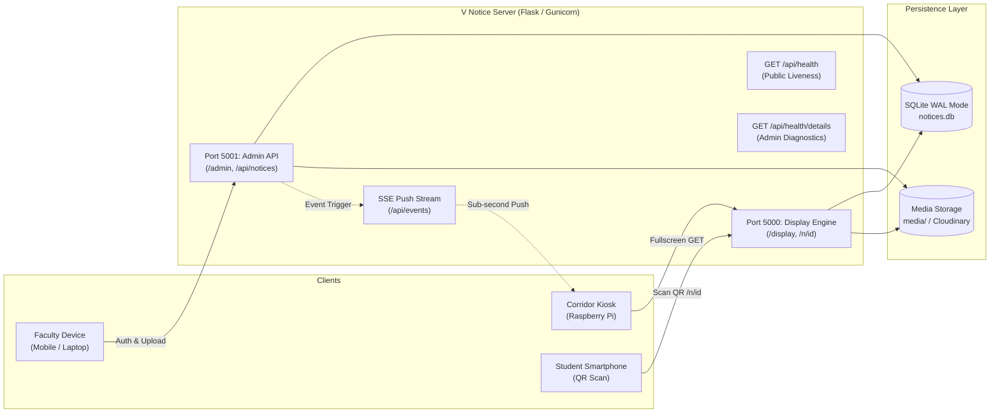

# V Notice

<p align="center">
  
  <br />
  <strong>Smart Digital Notice Board & Announcement Kiosk Platform</strong>
  <br />
  <em>Offline-first digital signage designed for college campus corridors, department lobbies, and academic labs.</em>
</p>

<p align="center">
  <a href="https://www.python.org/"></a>
  <a href="https://palletsprojects.com/p/flask/"></a>
  <a href="https://www.sqlite.org/"></a>
  <a href="https://www.raspberrypi.com/"></a>
  <a href="#testing"></a>
  <a href="#license"></a>
</p>

---

## Table of Contents

- [Overview](#overview)
- [Visual Showcase](#visual-showcase)
- [Key Features](#key-features)
- [System Architecture](#system-architecture)
- [Health & Monitoring Endpoints](#health--monitoring-endpoints)
- [Quick Start](#quick-start)
- [Configuration Reference](#configuration-reference)
- [Project Structure](#project-structure)
- [Security & Resilience](#security--resilience)
- [Testing](#testing)
- [Deployment Notes](#deployment-notes)
- [Roadmap & Contributing](#roadmap--contributing)
- [Credits & License](#credits--license)

---

## Overview

Traditional college paper notice boards suffer from physical clutter, print delays, and constant manual upkeep. Commercial digital signage solutions, on the other hand, require expensive recurring SaaS subscriptions, fragile cloud connections, and heavy client runtimes that easily crash low-cost hardware.

**V Notice** bridges this gap:
- **Ultra-lightweight:** Operates on standard Raspberry Pi units (3B+, 4, 5) with a strict memory footprint under **60 MB RAM**.
- **Mobile Publishing:** Faculty and department administrators can publish announcements with flyers, videos, or voice clips from any smartphone in under 30 seconds.
- **Offline-First Resilience:** Client-side caching and Service Worker architecture guarantee **zero blank screens** during network drops or Wi-Fi interruptions.
- **Instant Student Interaction:** Passersby can scan dynamic high-DPI QR codes to view, share, or download flyers and add academic deadlines directly to their phone calendar (`.ics`).

---

## Visual Showcase

| Corridor Kiosk Display (1080p FHD) | Mobile Admin Publishing Portal |
| :---: | :---: |
|  |  |

| Mobile Public Notice Page (`/n/<id>`) | National Flag Ceremony (11:00 AM) |
| :---: | :---: |
|  |  |

| Voice Notice with Audio Waveform | Admin Dashboard & Department Targeting |
| :---: | :---: |
|  |  |

---

## Key Features

### 📺 Corridor Display Engine
- **Multi-Format Rotation:** Smoothly cycles images (PNG, JPEG, WebP), videos (MP4, WebM), voice announcements, and formatted text cards.
- **Apple TV-Style Backdrop:** Intelligent ambient blur (`filter: blur(40px)`) frames portrait 3:4 and 4:3 flyers on 16:9 widescreen TVs without awkward black letterboxing.
- **Dynamic Text Auto-Sizing:** Real-time font calculation ensures announcements remain legible from 5 to 10 meters down the hallway.
- **Live Sidebar Rail:** Real-time digital clock, campus weather widget, upcoming announcement queue, and high-DPI QR code.
- **Deterministic Color Theming:** Notice IDs generate beautiful, reproducible gradient backdrops for text-only notices.

### 📱 Administration & Department Targeting
- **Mobile-First CMS:** Fully responsive publishing portal optimized for quick smartphone uploads between classes.
- **Multi-Department Filtering:** Route announcements to individual departmental screens (e.g., `CMPN`, `EXCS`, `MECH`) or broadcast campus-wide to `ALL`.
- **1-Click Expiration Presets:** Quick buttons for `End of Today`, `3 Days`, `1 Week`, or `1 Month`, plus custom datetime pickers.
- **Client-Side Aspect Ratio Guidance:** Live dimension badge warns users if an uploaded flyer does not match common display ratios before uploading.
- **Comprehensive Audit Trail:** Logs all creations, modifications, restorations, and deletions with client IP tracking.

### 🌐 Public Notice Landing (`/n/<id>`)
- **Direct QR Access:** Scanning the on-screen QR code opens a mobile-optimized notice card directly in the student's browser.
- **Native OS Sharing:** Integrated with the Web Share API for one-tap saving to iOS Photos and Android Gallery.
- **Calendar Event Export:** One-click generation of `.ics` calendar files for exams, assignment deadlines, and guest lectures.
- **Anti-Enumeration Protection:** Inactive, scheduled, or invalid notices return identical HTTP 404 responses to prevent ID scraping.

### 🔊 Audio Policy & Scheduled Ceremonies
- **Dual-Opt-in Video Sound:** Videos only play audio when sound is enabled on *both* the notice (`play_sound: 1`) and the screen configuration (`sound_enabled: 1`).
- **Voice Notice Recordings:** Record audio announcements directly in the browser with normalized waveforms and a 120-second cap.
- **Daily Flag Ceremony:** Automated 11:00 AM Indian National Flag ceremony running for exactly 52 seconds with zero audio bleed to external campus sound systems.

---

## System Architecture

V Notice supports two deployment architectures out of the box:



1. **Mode A: Cloud Unified (Render, Railway, Fly.io, VPS)**
   - Runs a single WSGI process (`app:unified_app`) on the assigned `$PORT`.
   - Admin portal is accessible under `/admin` protected by session cookies, CSRF tokens, and rate limits.
2. **Mode B: Dual-Port Air-Gapped Campus Server (Raspberry Pi / Local LAN)**
   - **Port 5000 (Display Kiosk):** Strictly read-only kiosk engine and student `/n/<id>` landing. Contains no mutation routes or admin secrets.
   - **Port 5001 (Admin CMS):** Dedicated management portal requiring authentication, rate limiting, and CSRF verification.

---

## Health & Monitoring Endpoints

V Notice implements a tiered health check model designed for orchestrators, Docker, Kubernetes probes, and uptime monitors:

| Endpoint | Access | Response Time | Description |
| :--- | :---: | :---: | :--- |
| `GET /api/health` | **Public** | **<5 ms** | **Lightweight Liveness Check.** Returns HTTP 200 `{"status": "ok"}`. Performs zero database queries, zero file scans, and zero memory profiling. Responds instantly even during heavy SQLite write locks. |
| `GET /api/health/details` | **Admin Only** | ~10–20 ms | **Full Diagnostic Health.** Requires admin credentials (`X-Password: <ADMIN_PASSWORD>`). Returns system uptime, database WAL status, notice/screen counters, storage writability, free disk space, and process RSS memory footprint. |

#### Example: Public Liveness Probe
```bash
curl http://localhost:5000/api/health
# Response: HTTP 200 OK
# {"status":"ok"}
```

#### Example: Authenticated Diagnostic Inspection
```bash
curl -H "X-Password: your_admin_password" http://localhost:5000/api/health/details
# Response: HTTP 200 OK
# {
#   "status": "healthy",
#   "app": "vnotice-unified",
#   "version": "2.0.0",
#   "uptime_seconds": 1420.5,
#   "memory_rss_mb": 41.2,
#   "database": {"connected": true, "journal_mode": "wal", "notices_count": 12, "screens_count": 6},
#   "storage": {"media_dir": "media", "writable": true, "free_space_mb": 14320.0}
# }
```

---

## Quick Start

### 🪟 Windows (Local Development)

```powershell
# 1. Clone repository and set up virtual environment
git clone https://github.com/anrix05/V-Notice.git
cd V-Notice
python -m venv venv
.\venv\Scripts\activate

# 2. Install dependencies
pip install -r requirements.txt

# 3. Start local dual-port servers
.\start.bat
```
- **Display Kiosk:** `http://localhost:5000` (or `http://localhost:5000/display/ALL`)
- **Admin Portal:** `http://localhost:5001/admin` *(Default password: `vnotice2026`)*
- **Chromium Kiosk Shortcut:** `.\scripts\windows\start_display.bat`

---

### 🐧 Linux & macOS

```bash
# 1. Set up virtual environment
python3 -m venv venv
source venv/bin/activate

# 2. Install dependencies and run
pip install -r requirements.txt
./start.sh
```
- **Launch Chromium Kiosk:** `./scripts/linux/start_display.sh`

---

### 🍓 Raspberry Pi (Corridor Kiosk Installation)

Automated 1-click deployment configuring boot autostart, power management, screen saver suppression, and video autoplay policies:

```bash
# Make script executable and run installer
chmod +x deploy/raspberry-pi/install_rpi.sh
./deploy/raspberry-pi/install_rpi.sh

# Optional: bind directly to a specific department display
DEPARTMENT_CODE=CMPN ./deploy/raspberry-pi/install_rpi.sh

# Or configure a display-only thin client pointing to a remote server
./deploy/raspberry-pi/setup_rpi_kiosk_display_only.sh https://v-notice.onrender.com/display/ALL
```

---

### ☁️ Cloud Deployment (Render, Railway, VPS)

1. Connect the repository as a Web Service.
2. **Build Command:** `pip install -r requirements.txt`
3. **Start Command:** `gunicorn app:unified_app -c gunicorn.conf.py`
4. Set required environment variables: `SECRET_KEY` and `ADMIN_PASSWORD_HASH`.

---

## Configuration Reference

Configure settings via `.env` file or hosting provider environment variables:

| Variable | Description | Default | Environment |
| :--- | :--- | :---: | :---: |
| `ADMIN_PASSWORD` | Fallback plaintext admin password | `vnotice2026` | Dev / Local |
| `ADMIN_PASSWORD_HASH` | Cryptographic Werkzeug password hash | None | **Production** |
| `SECRET_KEY` | Flask session cookie encryption secret | Ephemeral | **Production** |
| `PRODUCTION` | Enforces production security checks | `false` | Recommended |
| `DISPLAY_PORT` | Port for read-only kiosk display (Mode B) | `5000` | Local |
| `ADMIN_PORT` | Port for admin management portal (Mode B) | `5001` | Local |
| `PORT` | Dynamic single port assigned by cloud providers | `5000` | Cloud (Mode A) |
| `STORAGE_DIR` | Base directory for database and media | `./` | All |
| `DB_FILE` | Path to SQLite database file | `./notices.db` | All |
| `MEDIA_DIR` | Path to media upload directory | `./media` | All |
| `CLOUDINARY_URL` | Cloudinary connection string for cloud media | None | Optional |
| `MAX_UPLOAD_MB` | Maximum flyer or video upload size | `200` | All |
| `VIDEO_SOUND_ENABLED`| Master toggle for unmuted video playback | `true` | All |
| `VOICE_NOTICES_ENABLED`| Master toggle for voice note recordings | `true` | All |
| `FLAG_EVENT_ENABLED` | Master toggle for 11:00 AM flag ceremony | `true` | All |
| `WEATHER_ENABLED` | Master toggle for sidebar weather widget | `true` | All |
| `WEATHER_LABEL` | Display name for campus location | `Mumbai` | All |
| `SSE_ENABLED` | Master toggle for Server-Sent Events push | `false` | All |
| `POLL_INTERVAL_SECONDS`| Fallback HTTP polling interval | `5` | All |

---

## Project Structure

```text
V-Notice/
├── app.py                      # Application factories (Display, Admin, Unified)
├── config.py                   # Environment configuration & constants
├── storage.py                  # SQLite database engine, migrations & media storage
├── security.py                 # Rate limiting, CSRF tokens & password hashing
├── gunicorn.conf.py            # Production WSGI server configuration
├── templates/                  # Jinja2 templates (display, admin, public views)
├── static/                     # CSS design tokens, vanilla JS engines & brand vectors
├── deploy/                     # Deployment tooling for Raspberry Pi, systemd & tunnels
│   ├── raspberry-pi/           # Automated corridor kiosk installers
│   └── tunnel/                 # Cloudflare tunnel configurations
├── docs/                       # Architectural specs, decisions, PRD & testing guides
├── scripts/                    # Platform runners for Windows and Linux
├── assets/                     # Marketing vectors, posters & design templates
└── tests/                      # Automated test suite (Pytest & Playwright)
```

---

## Security & Resilience

- **Physical Network Isolation:** On-campus kiosks run on Port 5000 with zero mutation endpoints.
- **Timing-Safe Authentication:** Cryptographic password verification prevents timing-channel side attacks.
- **Brute-Force Lockout:** In-memory rate limiting locks out IP addresses after 5 failed login attempts for 10 minutes.
- **CSRF Token Verification:** All state modifications require valid session CSRF tokens (exempt for authenticated `X-Password` API calls).
- **Magic-Byte File Sniffing:** Verifies true file binary headers before saving files to disk.
- **Disk Protection GC:** Automated garbage collection deletes orphaned media files older than 10 minutes, protecting Raspberry Pi SD cards.

---

## Testing

The comprehensive test suite covers database persistence, security boundaries, audio policies, UI layout, and liveness endpoints:

```bash
# Run unit, integration, and security tests
python -m pytest tests/test_quality_observability_phase7.py tests/test_security_phase2.py tests/test_storage_phase1.py

# Run all core non-browser tests
python -m pytest -q -k "not playwright"

# Run complete suite with browser checks (requires local servers running on 5000/5001)
python -m pytest -q --timeout=60
```

---

## Deployment Notes

- **Campus Captive Portals:** Physical kiosks connected via captive-portal Wi-Fi cannot pass web authentication headlessly. Connect kiosks via wired Ethernet, an 802.1X machine-credential network, or have campus IT whitelist the Raspberry Pi MAC address.
- **Clock Synchronization:** Daily events (such as the 11:00 AM flag ceremony) require accurate wall-clock time. Ensure `systemd-timesyncd` is active with campus NTP servers or attach a hardware DS3231 I2C RTC module.
- **Flag Rehearsal Run:** Test the ceremony anytime from the Admin portal Settings tab or via `POST /api/admin/events/flag/<event_id>/test-run`.

---

## Roadmap & Contributing

Contributions are welcome! Please review our [Contributing Guidelines](CONTRIBUTING.md) and [Security Policy](SECURITY.md) before submitting pull requests.

- [ ] PostgreSQL backend adapter for multi-node deployments.
- [ ] TOTP 2FA and institutional LDAP / SAML single sign-on.
- [ ] Role-based access control for student council delegates.
- [ ] Multi-tenant support for multi-campus university networks.

---

## Credits & License

Built with ❤️ for college campuses and academic departments.

- **License:** Open source under the terms of the project [LICENSE](LICENSE) (or custom institution terms).
- **Third-Party Libraries:** See [docs/THIRD_PARTY.md](docs/THIRD_PARTY.md) for licensing notices for bundled fonts, icons, and dependencies.
