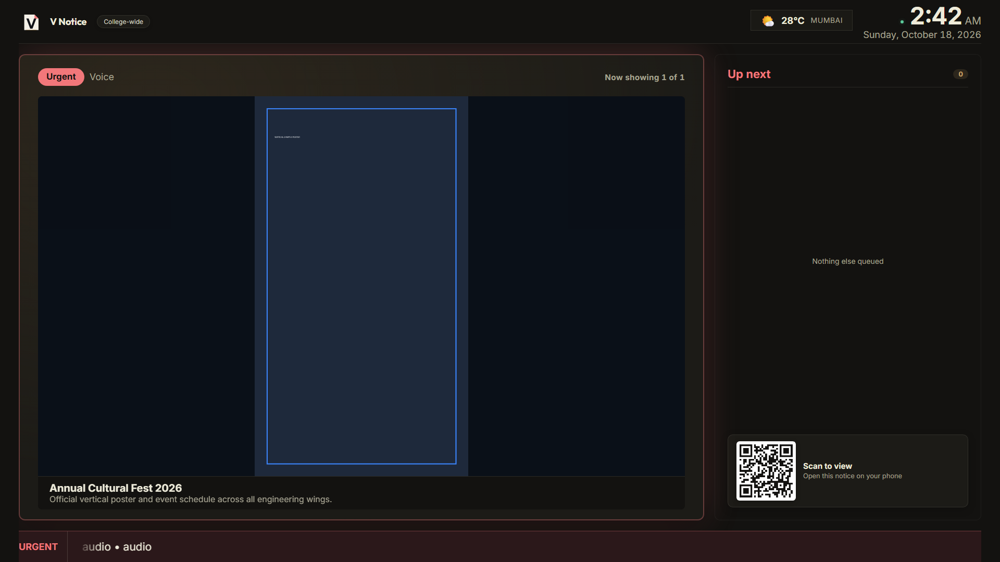
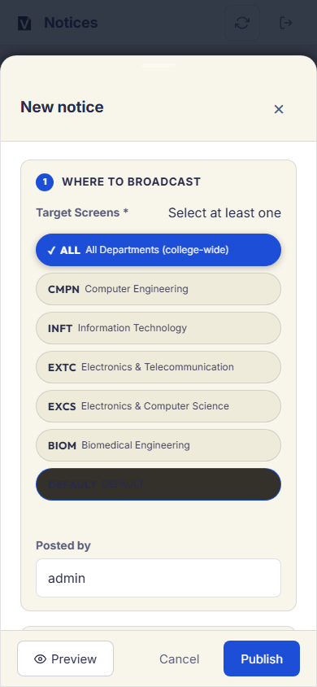
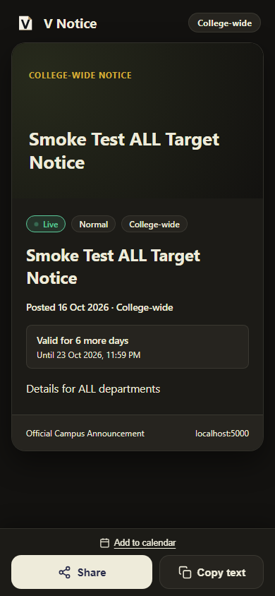
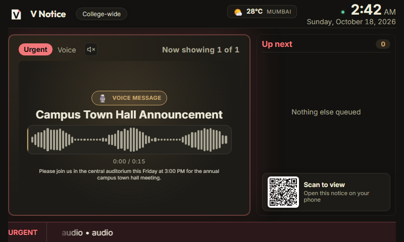
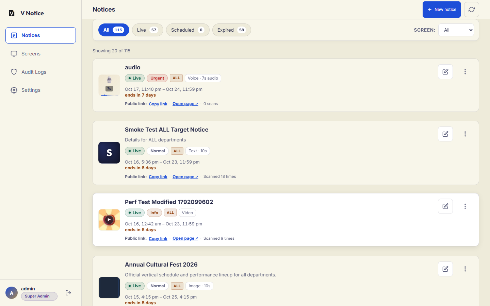
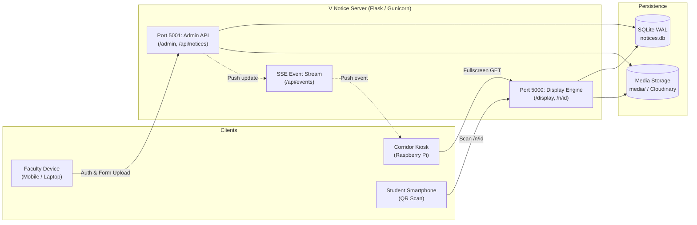

# V Notice

<p align="left">
  
</p>

Smart digital notice board and announcement kiosk platform for college departments.

[](https://www.python.org/)
[](https://palletsprojects.com/p/flask/)
[](#license)

---

## Table of contents

- [Overview](#overview)
- [Screenshots](#screenshots)
- [Features](#features)
- [How it works](#how-it-works)
- [Technical stack](#technical-stack)
- [Quick start](#quick-start)
- [Configuration](#configuration)
- [Project structure](#project-structure)
- [Security](#security)
- [Testing](#testing)
- [Deployment notes](#deployment-notes)
- [Roadmap](#roadmap)
- [Credits](#credits)
- [License](#license)

---

## Overview

V Notice is a lightweight, offline-first digital notice board and announcement kiosk system purpose-built for college campus corridors, department lobbies, and academic laboratories.

Traditional paper notice boards suffer from visual clutter, print delays, and physical maintenance overhead, while commercial digital signage SaaS platforms require recurring subscriptions, fragile cloud connections, and heavy client runtimes. V Notice runs on standard Raspberry Pi hardware (<60 MB RAM) and standard 18" to 22" monitors. It enables faculty to publish announcements from mobile devices in under 30 seconds, provides continuous corridor playback with zero blank screens during Wi-Fi drops, and lets passing students scan high-DPI QR codes to read flyers on their smartphones.

---

## Screenshots

| Corridor display (1080p full HD) | Mobile admin publishing |
| :---: | :---: |
|  |  |

| Mobile public notice page (`/n/<id>`) | National flag ceremony (11:00 AM) |
| :---: | :---: |
|  |  |

| Voice notice announcement | Admin management dashboard |
| :---: | :---: |
|  |  |

---

## Features

### Display
- Dynamic carousel rotation supporting images (PNG, JPEG, WebP), videos (MP4, WebM), voice recordings, and formatted text.
- Apple TV-style blurred backdrop (`filter: blur(40px)`) that frames vertical 3:4 and 4:3 flyers on 16:9 widescreen monitors without letterboxing.
- Dynamic text auto-sizing algorithm calculating viewport-proportional typography for readability from 5 to 10 meters away.
- High-contrast sidebar rail displaying live digital clock, campus weather, upcoming notice queue, and high-DPI QR code.
- Deterministic background color gradients generated from notice identifiers for text announcements without imagery.

### Administration
- Mobile-first responsive publishing dashboard with three-layer pinned modal layout.
- One-click expiration presets (`End of Today`, `3 Days`, `1 Week`, `1 Month`) alongside custom date and time pickers.
- Real-time client-side image aspect ratio validation and dimension badge guidance.
- Multi-department screen targeting (publish to individual departments or broadcast to all boards).
- Full audit log tracking creation, edits, restores, and deletions with client IP addresses.

### Public notice page
- Dedicated mobile landing page (`/n/<id>`) served when students scan on-screen QR codes.
- Direct attachment download endpoint (`/n/<id>/file`) with data warnings for media exceeding 25 MB.
- Web Share API integration enabling one-tap saving to native iOS Photos and Android Gallery.
- Dynamic `.ics` calendar file generation for scheduled academic deadlines and events.
- Byte-for-byte invariant HTTP 404 response for inactive or invalid IDs to eliminate identifier enumeration.

### Scheduling
- Explicit start and auto-expiration timestamps with sub-second evaluation.
- Configurable per-slide display durations (defaults: 8 seconds for images, dynamic duration for video, 10 seconds for voice).
- Soft-delete recovery mechanism allowing administrators to restore accidentally archived announcements.

### Sound and voice
- Selective video sound architecture: video audio plays only when enabled on both the notice (`play_sound: 1`) and the screen (`sound_enabled: 1`). Controlled by `VIDEO_SOUND_ENABLED` (default: `true`).
- Recorded voice announcements with waveform visualization and quiet recording normalization. Controlled by `VOICE_NOTICES_ENABLED` (default: `true`, max 120 seconds).
- Silent WAV pre-buffering and enterprise policy configurations to satisfy browser autoplay requirements without manual user interaction.

### Daily flag screen
- Automated 11:00 AM Indian National Flag screen ceremony lasting 52 seconds. Controlled by `FLAG_EVENT_ENABLED` (default: `true`).
- Strictly visual vector rendering with zero audio playback, preserving separation from external campus audio hardware.
- High operational precedence overriding active announcements for the event duration.

### Offline resilience and Raspberry Pi
- Complete client-side caching in `localStorage` and Service Worker (`sw.js`). Notices continue rotating indefinitely during network interruptions.
- Automated media garbage collection removing unreferenced disk files older than 10 minutes to protect SD card storage.
- Automated 1-click installer and systemd service units for unattended corridor boot.

---

## How it works

V Notice operates across two deployment modes:

1. **Mode A: Cloud unified (Render / Railway):** Gunicorn runs a single WSGI application (`app:unified_app`) on the assigned `$PORT`. The admin portal is served under `/admin` and protected by session cookies and passwords.
2. **Mode B: On-campus dual-port (Raspberry Pi / LAN):** Two separate HTTP servers run within the process:
   - Port `5000`: Dedicated display kiosk and public notice viewer. Strictly read-only with no administrative routes.
   - Port `5001`: Dedicated administrative CMS. Password-protected, enforcing CSRF tokens and rate limits.



For complete technical specifications, database schemas, and data flow diagrams, see [docs/ARCHITECTURE.md](docs/ARCHITECTURE.md).

---

## Technical stack

| Layer | Technology | Details |
| :--- | :--- | :--- |
| **Backend** | Python 3.10+, Flask 3.0+ | Lightweight WSGI application, <60 MB RAM footprint |
| **WSGI server** | Gunicorn | Production process manager configured via `gunicorn.conf.py` |
| **Frontend** | Vanilla JavaScript (ES6+), HTML5, CSS3 | Zero frontend build steps; no React, Vue, or Tailwind |
| **Design system** | CSS Custom Properties (`static/css/tokens.css`) | Document sheet monogram branding, high-contrast dark palette |
| **Database** | SQLite 3 | WAL mode, 5000 ms busy timeout, atomic transactions |
| **Real-time** | Server-Sent Events (SSE) & conditional polling | Sub-second notice propagation with 5-second HTTP fallback |
| **Media probe** | `ffprobe` | Magic-byte validation, audio track verification |
| **Hardware** | Raspberry Pi 3B+ / 4 / 5, HDMI Display | 1080p, 900p, 720p, and 800x480 LCD support |

---

## Quick start

### Windows (Local development)

Tested commands:
```powershell
python -m venv venv
.\venv\Scripts\activate
pip install -r requirements.txt
start.bat
```
- Display kiosk: `http://localhost:5000` (or `http://localhost:5000/display/EXCS`)
- Admin dashboard: `http://localhost:5001/admin` (default password: `vnotice2026`)
- Launch Chrome or Edge in kiosk mode: `scripts\windows\start_display.bat`

### Linux and macOS

Tested commands:
```bash
python3 -m venv venv
source venv/bin/activate
pip install -r requirements.txt
./start.sh
```
- Launch Chromium kiosk: `./scripts/linux/start_display.sh`

### Raspberry Pi (Corridor installation)

Tested commands:
```bash
chmod +x deploy/raspberry-pi/install_rpi.sh
./deploy/raspberry-pi/install_rpi.sh
```
- Installs Chromium, unclutter, ffmpeg, and Python dependencies.
- Configures `/etc/chromium/policies/managed/vnotice_autoplay.json` for unmuted video playback.
- Installs and enables `vnotice.service` systemd auto-restart service.
- Configures autostart kiosk session on boot.
- Custom department code: `DEPARTMENT_CODE=CMPN ./deploy/raspberry-pi/install_rpi.sh`
- Display-only thin client: `./deploy/raspberry-pi/setup_rpi_kiosk_display_only.sh https://v-notice.onrender.com/display/ALL`

### Cloud deployment (Render)

1. Connect your repository to Render as a Web Service.
2. Build command: `pip install -r requirements.txt`
3. Start command: `gunicorn app:unified_app -c gunicorn.conf.py`
4. Set environment variables: `SECRET_KEY` and `ADMIN_PASSWORD_HASH`.

---

## Configuration

All configuration is managed through environment variables (defined in `.env` or cloud dashboards):

| Variable | Purpose | Default | Required |
| :--- | :--- | :---: | :---: |
| `ADMIN_PASSWORD` | Fallback plaintext admin password | `vnotice2026` | No |
| `ADMIN_PASSWORD_HASH` | Cryptographic Werkzeug hash for admin authentication | None | Recommended |
| `SECRET_KEY` | Session cookie encryption secret | Ephemeral | Yes (in production) |
| `PRODUCTION` | Enables strict production validation (refuses insecure defaults) | `false` | Recommended |
| `FLASK_ENV` | Environment mode (`development` or `production`) | `development` | No |
| `DISPLAY_PORT` | Port for read-only kiosk display (Mode B) | `5000` | No |
| `ADMIN_PORT` | Port for admin management portal (Mode B) | `5001` | No |
| `PORT` | Dynamic single port assigned by cloud providers (Mode A) | `5000` | Cloud only |
| `STORAGE_DIR` | Base directory for database and uploads | `./` | No |
| `DB_FILE` | Path to SQLite database file | `./notices.db` | No |
| `MEDIA_DIR` | Path to uploaded notice media directory | `./media` | No |
| `CLOUDINARY_URL` | Cloudinary credentials URL for cloud media storage | None | Optional |
| `MAX_UPLOAD_MB` | Maximum allowed upload size in megabytes | `200` | No |
| `VIDEO_SOUND_ENABLED` | Master toggle for video sound playback policy | `true` | No |
| `VOICE_NOTICES_ENABLED`| Master toggle for voice announcement recordings | `true` | No |
| `FLAG_EVENT_ENABLED` | Master toggle for daily 11:00 AM flag ceremony | `true` | No |
| `FLAG_TRIGGER_TOKEN` | Shared secret token for manual flag broadcast trigger | None | Optional |
| `WEATHER_ENABLED` | Master toggle for corridor weather widget | `true` | No |
| `WEATHER_LABEL` | City or campus name shown on weather card | `Mumbai` | No |
| `SSE_ENABLED` | Enables Server-Sent Events push stream | `false` | No |
| `POLL_INTERVAL_SECONDS`| Fallback HTTP polling interval in seconds | `5` | No |

---

## Project structure

| Folder | Purpose |
| :--- | :--- |
| `docs/` | Architecture specs ([docs/ARCHITECTURE.md](docs/ARCHITECTURE.md)), setup guide ([docs/SETUP.md](docs/SETUP.md)), design system ([docs/DESIGN.md](docs/DESIGN.md)), product requirements ([docs/PRD.md](docs/PRD.md)), decisions log ([docs/DECISIONS.md](docs/DECISIONS.md)), QA plan ([docs/TESTING.md](docs/TESTING.md)), rules ([docs/RULES.md](docs/RULES.md)), memory ([docs/MEMORY.md](docs/MEMORY.md)), third-party notices ([docs/THIRD_PARTY.md](docs/THIRD_PARTY.md)). |
| `deploy/` | Production deployment tooling: Raspberry Pi installers (`deploy/raspberry-pi/`), systemd units (`vnotice.service`), and Cloudflare tunnels (`deploy/tunnel/`). |
| `scripts/` | Platform runners (`scripts/windows/`, `scripts/linux/`), brand asset generators, and visual regression capture tools. |
| `assets/` | Marketing poster layout templates, vector assets, and export scripts (`assets/poster/`). |
| `archive/` | Historical verification screenshot runs, UI audit snapshots, and legacy database backups (`archive/legacy/`, `archive/verification/`). |
| `static/` | Client static assets: design tokens (`css/tokens.css`), stylesheets, vanilla JavaScript engines, self-hosted WOFF2 fonts, brand vectors, and Service Workers (`sw.js`, `admin-sw.js`). |
| `templates/` | Jinja2 HTML templates for display kiosk, admin portal, and mobile public views. |
| `tests/` | Pytest test suite covering storage CRUD, rate limiting, SSE sync, video sound isolation, and UI responsiveness. |
| `media/` | Runtime disk storage for uploaded flyers, videos, and voice notes (gitignored). |

---

## Security

### Defenses in place
- **Network isolation:** Physical kiosks run on Port 5000 with zero write routes exposed.
- **CSRF protection:** All administrative POST, PUT, and DELETE mutations require valid session CSRF tokens.
- **Brute-force rate limiting:** In-memory tracking locks out IP addresses exceeding 5 failed login attempts per 10 minutes.
- **Cryptographic authentication:** Password verification uses Werkzeug constant-time hashes (`ADMIN_PASSWORD_HASH`) with constant-time plaintext fallback.
- **Magic-byte validation:** Uploaded files are inspected for true file signatures before storage.
- **Zero-leakage 404 responses:** Missing, scheduled, or expired notices queried via `/n/<id>` return byte-identical HTTP 404 responses to prevent identifier enumeration.
- **Audit logging:** All notice and screen state modifications are recorded in the `audit_logs` database table.

### Known limitations
- No Single Sign-On (SSO) or multi-factor authentication (2FA) is implemented currently.
- In single-port cloud mode, the `/admin` route is accessible over the public internet (protected solely by password and rate limiting).
- The system has not undergone third-party commercial penetration testing.
- Render free tier instances use ephemeral disks; notices and media reset on container redeploy unless a persistent disk volume or Cloudinary is configured.
- Cloudinary integration delegates media storage to a third-party vendor.

### Reporting a vulnerability
If you discover a security issue, please email `[SECURITY CONTACT EMAIL / PLACEHOLDER]` rather than opening a public issue. Include reproducible steps and affected components.

---

## Testing

The automated test suite contains 170 test cases covering backend storage, authentication, rate limits, audio policy, and UI rendering:

```bash
# Run backend and unit tests
python -m pytest -q -k "not playwright"

# Run complete test suite with live browser checks
python -m pytest -q --timeout=60 -p no:cacheprovider
```

> **Note on Playwright tests:** Tests requiring live browser navigation require the dual servers to be running on ports 5000 and 5001. When running offline or without running servers, 122 unit and integration tests pass 100%.

---

## Deployment notes

- **Raspberry Pi kiosk:** Run `./deploy/raspberry-pi/install_rpi.sh` to configure unattended boot, disable display power management (`xset -dpms`), hide the idle mouse cursor (`unclutter`), and enable the Chromium kiosk.
- **Campus Wi-Fi portal caveat:** Physical corridor kiosks connected via captive-portal Wi-Fi cannot complete web authentication headlessly. Use Ethernet, an 802.1X enterprise network with machine credentials, or whitelist the Raspberry Pi MAC address with campus IT.
- **Clock synchronization:** Daily events (such as the 11:00 AM flag ceremony) rely on accurate wall-clock time. Ensure `systemd-timesyncd` is active with reachable campus NTP servers, or attach an inexpensive DS3231 I2C real-time clock (RTC) module.
- **Flag ceremony rehearsal:** To test the flag ceremony at any time without altering the system clock, administrators can trigger a rehearsal run from the Settings tab in the Admin portal or via `POST /api/admin/events/flag/<event_id>/test-run`.

---

## Roadmap

Planned improvements discussed for future iterations:
- [ ] External managed database support (PostgreSQL) for multi-node deployments.
- [ ] Multi-factor authentication (TOTP 2FA) and campus LDAP / SAML single sign-on.
- [ ] Internal-only notices with restricted visibility (faculty lounge displays).
- [ ] Multi-tenant organization support for multi-campus institutional deployments.

---

## Credits

Built at **[COLLEGE NAME]** by **[TEAM NAMES]**.  
Guided by **[GUIDE NAME]**.  

Recognition: **[ADD EXHIBITION RESULT]**

---

## License

License: to be decided by the authors (MIT, Apache-2.0, or All Rights Reserved).  
For third-party software, fonts, and library licenses, refer to [docs/THIRD_PARTY.md](docs/THIRD_PARTY.md).
