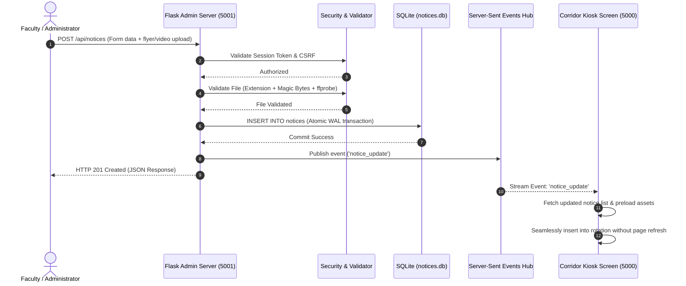
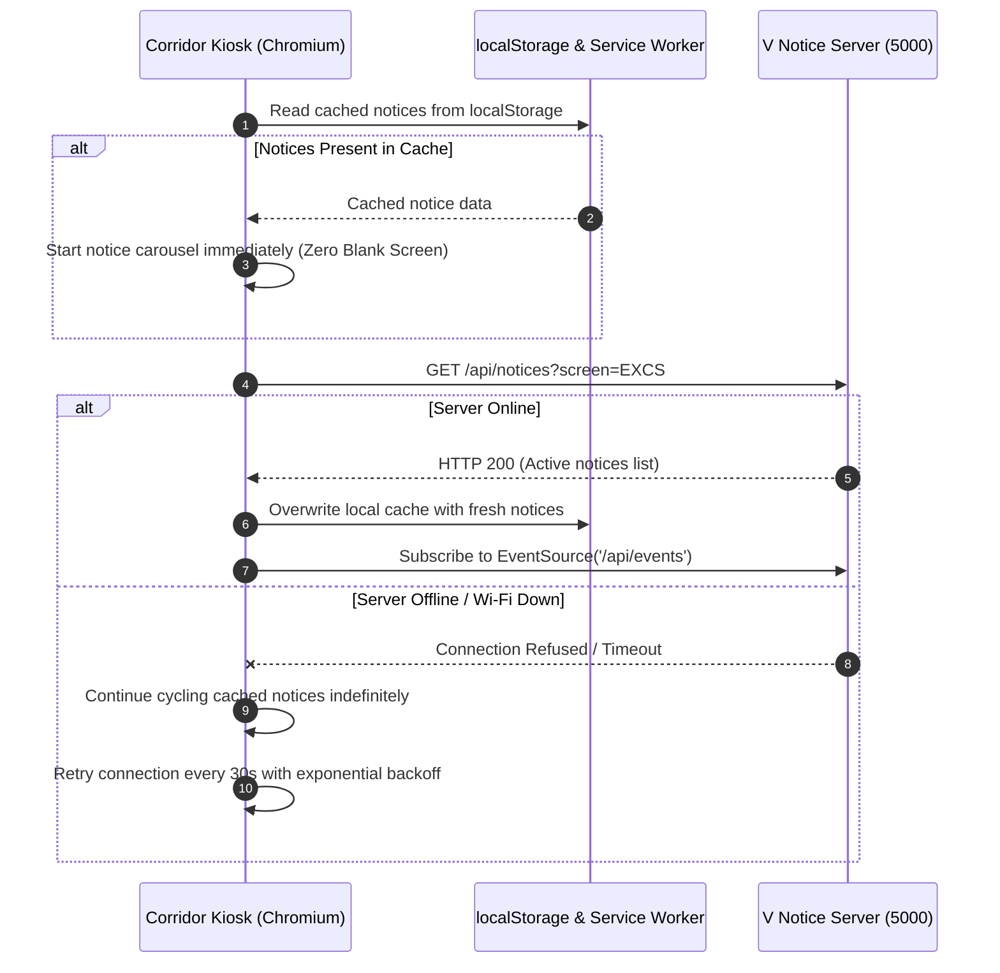

# V Notice — System Architecture & Technical Specification

> **Product:** V Notice (Smart Digital Notice Board & Campus Kiosk)  
> **Version:** 2.2.0  
> **Target Platforms:** Raspberry Pi (3B+, 4, 5), Standard Monitors (1080p, 900p, 720p), Mobile Web (iOS/Android), and Cloud (Render / Railway)  
> **Status:** Production-Hardened Living Architecture Document  
> **Last Verified:** October 2026  

---

## 1. System Overview & Core Philosophy

**V Notice** is an enterprise-grade, offline-first digital notice board platform purpose-built for college campus corridors, department lobbies, and academic kiosks. Designed to operate on low-resource hardware (<60MB RAM footprint), it bridges the gap between administrators, faculty, and students by providing:

1. **Instant Real-Time Broadcasting:** Notice creations, updates, and cancellations push from faculty smartphones to corridor displays in under 500ms via Server-Sent Events (SSE) or 5-second polling.
2. **Offline-First Resilience:** Corridor displays cache notice data in `localStorage` and assets via Service Workers (`sw.js`). Displays continue uninterrupted carousel playback during network dropouts with zero blank screens.
3. **Physical Kiosk Isolation:** Kiosks run on Port `5000` (strictly read-only, exposing no administrative or mutation routes). The administrative dashboard runs on Port `5001` with cryptographic authentication and CSRF protection.
4. **Zero Frontend Framework Overhead:** No React, Vue, Angular, or Tailwind runtime. Built entirely with standards-compliant Vanilla JavaScript (ES6+), semantic HTML5, and hardware-accelerated CSS3.
5. **Adaptive Visual Hierarchy:** Automatic Apple TV frosted backdrop blur for vertical posters (3:4, 4:3), dynamic text auto-fit font sizing based on viewport and text length, and high-DPI scan-to-phone QR codes.

---

## 2. Cleaned Repository Directory Tree

Following the repository cleanup, all components are cleanly partitioned:

```text
D:\V Notice\
├── app.py                             # Core Flask application factory & route dispatchers
├── config.py                          # Central environment & configuration manager
├── security.py                        # Cryptographic auth, rate limiting, and magic-byte validation
├── storage.py                         # SQLite WAL engine, migrations, and media backends
├── run_admin.py                       # Standalone runner for Port 5001 Admin Portal
├── run_display.py                     # Standalone runner for Port 5000 Kiosk Display
├── gunicorn.conf.py                   # Production WSGI server configuration
├── requirements.txt                   # Minimal pinned Python dependencies (Flask, Werkzeug)
├── Procfile                           # Cloud platform deployment entrypoint (Railway / Heroku)
├── railway.json                       # Railway deployment manifest
├── README.md                          # Repository handbook & quick-start guide
├── CHANGELOG.md                       # Version changelog and release notes
├── .env.example                       # Documented environment variable template
├── .gitignore                         # Comprehensive ignore rules
│
├── docs/                              # Authoritative documentation suite
│   ├── ARCHITECTURE.md                # This document: Complete technical blueprint
│   ├── SETUP.md                       # Comprehensive deployment manual (Pi, Cloud, Windows)
│   ├── DESIGN.md                      # Brand identity, design tokens, typography, and color rules
│   ├── PRD.md                         # Product requirements document & personas
│   ├── DECISIONS.md                   # Architectural Decision Records (ADRs 001 - 010)
│   ├── TESTING.md                     # QA test plans, matrices, and security verification
│   ├── RULES.md                       # Engineering constraints & coding contracts
│   └── MEMORY.md                      # Historical project context & development log
│
├── deploy/                            # Deployment scripts and system service units
│   ├── raspberry-pi/                  # Raspberry Pi automation
│   │   ├── install_rpi.sh             # 1-click installer (dependencies, autoplay, systemd)
│   │   ├── setup_rpi_kiosk_display_only.sh # Thin client installer for cloud-linked screens
│   │   ├── kiosk.sh                   # Chromium kiosk launcher (DPMS off, unclutter, audio click)
│   │   ├── vnotice.service            # Linux systemd auto-restart service unit
│   │   └── v-notice.service           # systemd unit alias
│   └── tunnel/                        # Cloudflare Quick Tunnel tools
│       ├── start_tunnel.sh            # Linux 1-click remote admin tunnel launcher
│       ├── start_tunnel.bat           # Windows 1-click remote admin tunnel launcher
│       └── stop_tunnel.bat            # Windows tunnel process terminator
│
├── scripts/                           # Maintenance and execution scripts
│   ├── windows/                       # Windows launchers
│   │   ├── start.bat                  # Local dual-server launcher
│   │   └── start_display.bat          # Kiosk Chrome/Edge launcher with autoplay flags
│   ├── linux/                         # Linux launchers
│   │   ├── start.sh                   # Local dual-server launcher
│   │   └── start_display.sh           # Chromium kiosk launcher
│   ├── generate_brand_assets.py       # Vector-to-raster brand asset generation utility
│   └── capture_verification_screenshots.py # Headless Playwright visual regression capture
│
├── assets/                            # Marketing and print design assets
│   └── poster/                        # High-DPI printable poster generator & vector layout
│       ├── generate.py                # Poster rendering engine
│       ├── export_and_verify.py       # High-DPI PDF and PNG exporter
│       ├── prepare_assets.py          # Poster asset processor
│       ├── index.html                 # 300 DPI CSS/HTML print poster template
│       ├── poster.pdf                 # Print-ready vector college poster
│       └── poster.png                 # Raster preview poster
│
├── archive/                           # Historical test records and legacy artifacts
│   ├── README.md                      # Inventory of archived materials
│   ├── legacy/                        # Legacy backups (notices.backup.json, old brand cuts)
│   └── verification/                  # Visual audit captures (mobile perf, text fit, voice)
│
├── static/                            # Frozen static assets served by Flask
│   ├── audio/                         # Silent WAV buffer for browser autoplay unlock
│   ├── brand/                         # Vector brand marks, lockups, and monograms
│   ├── css/                           # Styling (tokens.css, display.css, admin.css)
│   ├── fonts/                         # Self-hosted WOFF2 fonts (Inter, Outfit, Noto Sans Devanagari)
│   ├── icons/                         # Progressive Web App manifest icons
│   ├── images/                        # Application lockups and fallback imagery
│   ├── js/                            # Client engines (display.js, admin.js, flag_scheduler.js)
│   ├── sw.js                          # Kiosk display Service Worker
│   ├── admin-sw.js                    # Admin CMS Progressive Web App Service Worker
│   ├── manifest.json                  # PWA manifest
│   └── manifest.webmanifest           # Standards-compliant PWA manifest alias
│
├── templates/                         # Server-rendered Jinja2 templates
│   ├── display.html                   # Corridor kiosk presentation interface
│   ├── admin.html                     # Responsive admin management portal
│   ├── notice_public.html             # Standalone mobile notice landing page (/n/<id>)
│   ├── notice_detail.html             # Modal detail partial
│   └── screen_not_found.html          # Corridor diagnostic page for unregistered screen codes
│
├── tests/                             # Comprehensive automated pytest test suite (170 tests)
│   ├── conftest.py                    # Pytest fixtures and isolated SQLite setup
│   ├── fixtures/                      # Sample images, video, and audio test files
│   └── test_*.py                      # Unit, integration, security, and UI regression suites
│
├── media/                             # Runtime uploaded media storage (gitignored)
└── notices.db                         # Runtime SQLite database in WAL mode (gitignored)
```

---

## 3. High-Level Architecture & Operating Modes

```mermaid
flowchart TD
    subgraph Clients["Access Layer"]
        A["Faculty / Admin Device<br/>(Mobile / Laptop)"]
        B["Student Smartphone<br/>(QR Scan / Campus Wi-Fi)"]
        C["Corridor Kiosk Display<br/>(Raspberry Pi + 18-22' Monitor)"]
    end

    subgraph DualServer["Flask Application Core"]
        direction TB
        subgraph AdminPort["Admin Portal (Port 5001)"]
            AUTH["Security Layer<br/>(Hash / CSRF / Rate Limiter)"]
            ADMIN_API["Admin REST API<br/>(/api/notices, /api/screens)"]
            VALIDATOR["Upload Validator<br/>(Magic-Bytes / ffprobe)"]
        end

        subgraph DisplayPort["Kiosk & Public (Port 5000)"]
            KIOSK_VIEW["Display UI Engine<br/>(/display/&lt;code&gt;)"]
            SSE_HUB["SSE Event Stream<br/>(/api/events)"]
            PUB_VIEW["Public Mobile Notice<br/>(/n/&lt;id&gt;, /n/&lt;id&gt;/file)"]
        end
    end

    subgraph Storage["Storage & Persistence Layer"]
        SQLITE[("SQLite DB: notices.db<br/>(WAL Mode + Busy Timeout)")]
        MEDIA[("Media Storage<br/>(Local Disk / Cloudinary)")]
        GC["Automated Garbage Collector<br/>(&gt;10 min unreferenced cleanup)")]
    end

    A -->|Auth Request| AdminPort
    B -->|Scan QR /n/id| PUB_VIEW
    C -->|Fullscreen GET /display| KIOSK_VIEW

    ADMIN_API --> SQLITE
    VALIDATOR --> MEDIA
    ADMIN_API -->|Broadcast Event| SSE_HUB
    SSE_HUB -.->|Push Event Stream| KIOSK_VIEW
    KIOSK_VIEW --> SQLITE
    PUB_VIEW --> SQLITE
    PUB_VIEW --> MEDIA
    GC -.->|Clean Orphan Files| MEDIA
    GC -.->|Verify Notice References| SQLITE
```

### The Two Deployment Modes

| Deployment Paradigm | Mode A: Cloud Unified (Render / Railway) | Mode B: On-Campus Dual-Port (Raspberry Pi / LAN) |
| :--- | :--- | :--- |
| **Network Binding** | Binds Gunicorn to a single dynamic port: `0.0.0.0:$PORT` | Binds two distinct Flask servers: `0.0.0.0:5000` (Display) & `0.0.0.0:5001` (Admin) |
| **Access Control** | Admin portal available at `/admin`; all write APIs enforced with session/password auth | Kiosk port 5000 has **zero** write routes registered; admin routes exist only on port 5001 |
| **Storage Reality** | **Ephemeral by default on Render Free Tier** (resets on rebuild). Requires Render Persistent Disk mounted at `STORAGE_DIR` or `CLOUDINARY_URL` | **Persistent local storage** on SD card / SSD (`notices.db` + local `media/`) |
| **External Access** | Native global HTTPS (`https://v-notice.onrender.com`) | Local campus network with optional 1-click Cloudflare Quick Tunnel (`deploy/tunnel/start_tunnel.sh`) |

---

## 4. Subsystems & Technical Implementation

### 4.1 Storage Backends & Data Persistence

1. **SQLite in WAL Mode (`notices.db`):**
   - Operating mode: `PRAGMA journal_mode = WAL; PRAGMA busy_timeout = 5000; PRAGMA synchronous = NORMAL;`.
   - WAL (Write-Ahead Logging) permits unlimited concurrent readers (kiosk displays) while an administrator writes updates.
   - 5000ms busy timeout eliminates `sqlite3.OperationalError: database is locked`.
2. **Storage Backends (`storage.py`):**
   - **`LocalStorageBackend`:** Stores uploads in `MEDIA_DIR` (`media/`) with cryptographically secure random names (`<notice_id>_<token>.<ext>`).
   - **`CloudinaryStorageBackend`:** Configured via `CLOUDINARY_URL`. Uploads stream directly to Cloudinary; image/video URLs are stored in the database.
   - **Render Storage Truth:** On Render free web services, the disk is ephemeral. Notices and media reset upon redeployment unless:
     - A Render Persistent Disk is attached and `STORAGE_DIR` points to the mount, or
     - `CLOUDINARY_URL` is configured for media files.
3. **Automated Media Garbage Collection:**
   - Periodically scans disk against referenced database filenames.
   - Deletes only unreferenced files older than **10 minutes** (protects in-flight uploads by other faculty members).

### 4.2 Security Perimeter & Auth Model

- **Password Verification:** Supports `ADMIN_PASSWORD_HASH` (Werkzeug cryptographic hash) with constant-time `hmac.compare_digest` fallback for plaintext `ADMIN_PASSWORD`.
- **Brute-Force Rate Limiting:** In-memory `RateLimiter` restricts failed login attempts to 5 failures per 10 minutes per IP address with strict `Retry-After` enforcement.
- **Magic-Byte Sniffing:** Verifies uploaded files via initial byte headers (`\xFF\xD8\xFF` for JPEG, `\x89PNG` for PNG, `RIFF...WEBP` for WebP, `ftyp` for MP4).
- **Public 404 Invariance:** Every invalid, scheduled, expired, or deleted notice queried via `/n/<id>` returns the exact same byte-for-byte HTML 404 response. Eliminates ID enumeration.

### 4.3 Kiosk Display Engine

- **Rotation Carousel:** Rotates active notices according to configured slide durations (defaults: 8s image, dynamic duration for video, 10s voice memo).
- **Apple TV Frosted Backdrop:** Vertical flyers (3:4, 4:3) on 16:9 widescreen corridor monitors clone the media into a CSS blurred backdrop (`filter: blur(40px) brightness(0.6)`), centering the sharp original flyer in the foreground.
- **Dynamic Text Auto-Fit:** Analyzes notice title and body character lengths relative to viewport dimensions (1080p, 900p, 720p, 480p) and applies optimal clamp font sizes ensuring visibility from 10 meters away.
- **Audio Autoplay & Sound Policy:**
   - Wall displays must never emit unexpected loud sound. Video audio is permitted **only** when `notice.play_sound == 1` AND `screen.sound_enabled == 1`.
   - Browser autoplay restriction is bypassed on Raspberry Pi using Chromium Enterprise managed policy (`/etc/chromium/policies/managed/vnotice_autoplay.json`) and a 4-second background synthetic click (`xdotool click 1`).

### 4.4 Voice Announcements Subsystem

- **Limits:** Max audio duration 120 seconds (`MAX_VOICE_DURATION_SECONDS`), max upload size 10MB (`MAX_VOICE_UPLOAD_MB`).
- **Validation:** Inspected via `ffprobe` to ensure the uploaded file contains an audio stream and zero video streams.
- **Display Visualization:** Renders a CSS/SVG multi-bar audio waveform with quiet recording normalization (loudest frequency normalized to 100% bar height) and live elapsed time counter.

### 4.5 Scheduled Daily Events (National Flag Ceremony)

- **Schedule & Duration:** Triggers daily at 11:00 AM across all connected displays. Default duration is 52 seconds (the official duration of the Indian National Anthem).
- **Strict Visual-Only Constraint:** In accordance with architectural separation of concerns, V Notice plays **zero audio**. The college's separate hardware anthem audio box remains isolated.
- **Vector Rendering:** Renders a 3:2 Indian National Flag using pure SVG vector paths and CSS waving animations. Overrides all active notices for 52 seconds.

---

## 5. System Execution & Data Flows

### Notice Publishing & Push Broadcast Flow



### Kiosk Boot & Offline-First Playback Flow



---

## 6. Environment Variables Reference

| Variable | Default | Purpose & Description |
| :--- | :---: | :--- |
| `ADMIN_PASSWORD` | `vnotice2026` | Plaintext fallback administrative password. |
| `ADMIN_PASSWORD_HASH` | *Empty* | Werkzeug cryptographic password hash (takes precedence over plaintext password). |
| `SECRET_KEY` | *Generated* | Session cookie encryption secret. Mandatory in production mode. |
| `PRODUCTION` / `FLASK_ENV` | `false` / `development` | Strict production security mode (refuses to start on default/insecure secret key). |
| `DISPLAY_PORT` | `5000` | Port for the public read-only kiosk display server. |
| `ADMIN_PORT` | `5001` | Port for the password-protected administrative portal. |
| `PORT` | `5000` | Dynamic single port assigned by cloud PaaS (Render / Railway). |
| `STORAGE_DIR` | `./` | Root directory for SQLite database file and uploads. |
| `DB_FILE` | `./notices.db` | Absolute or relative path to SQLite database. |
| `MEDIA_DIR` | `./media` | Directory for uploaded notice flyers, videos, and voice memos. |
| `CLOUDINARY_URL` | *Empty* | Optional Cloudinary URL for persistent media hosting without persistent disks. |
| `MAX_UPLOAD_MB` | `200` | Maximum file upload limit in megabytes. |
| `MAX_CONTENT_LENGTH` | `209715200` | Maximum HTTP request body size in bytes (200MB). |
| `VIDEO_SOUND_ENABLED` | `true` | Master toggle for selective video sound playback. |
| `VOICE_NOTICES_ENABLED` | `true` | Feature toggle for voice notice recordings. |
| `MAX_VOICE_DURATION_SECONDS` | `120` | Maximum duration limit for recorded voice notices. |
| `MAX_VOICE_UPLOAD_MB` | `10` | Maximum file size for audio uploads. |
| `FLAG_EVENT_ENABLED` | `true` | Feature toggle for the daily 11:00 AM visual National Flag event. |
| `FLAG_TRIGGER_TOKEN` | *Empty* | Secret authorization token for ad-hoc manual flag broadcasts. |
| `WEATHER_ENABLED` | `true` | Master toggle for campus weather forecast widget. |
| `WEATHER_LABEL` | `Mumbai` | Display label for campus weather location. |
| `WEATHER_LAT` / `WEATHER_LON` | `19.0760` / `72.8777` | Geographical coordinates for Open-Meteo weather API queries. |
| `SSE_ENABLED` | `false` | Real-time SSE streaming toggle (default false on cloud sync-workers to avoid worker exhaustion). |
| `POLL_INTERVAL_SECONDS` | `5` | Fallback HTTP polling interval for display kiosks. |
| `LOG_LEVEL` | `INFO` | Application logging level (`DEBUG`, `INFO`, `WARNING`, `ERROR`). |

---

## 7. Known Limitations & Edge Cases

1. **Render Free Tier Ephemeral Storage:**
   - Free Render web service instances run on ephemeral containers. Files saved to the local disk (`notices.db` and `media/`) are erased when a Git build triggers a redeploy or the free container sleeps.
   - *Mitigation:* Attach a paid Render Persistent Disk and set `STORAGE_DIR`, or use `CLOUDINARY_URL` for cloud media storage.
2. **Gunicorn Sync-Worker SSE Thread Exhaustion:**
   - When running Gunicorn with synchronous workers (`worker_class = 'sync'`), holding long-lived SSE connections (`/api/events`) will consume worker threads and block regular HTTP requests.
   - *Mitigation:* `SSE_ENABLED` defaults to `false` in cloud deployments; clients use lightweight 304 conditional HTTP polling. For SSE in production, use gevent or threaded workers.
3. **Browser Autoplay Security Gate:**
   - Web browsers strictly prohibit unmuted audio playback without user gestures.
   - *Mitigation:* Configured on Raspberry Pi OS via Chromium enterprise managed policy JSON and a 4-second synthetic background click (`xdotool`). On third-party Smart TVs, videos without policy support default to muted rotation.
4. **Single-Node SQLite Concurrency Limits:**
   - While SQLite in WAL mode handles hundreds of concurrent display readers seamlessly, write throughput is limited to one writer at a time.
   - *Assessment:* For campus notice operations (dozens of daily announcements across 10-50 department screens), SQLite WAL provides sub-millisecond response times well within system thresholds.
